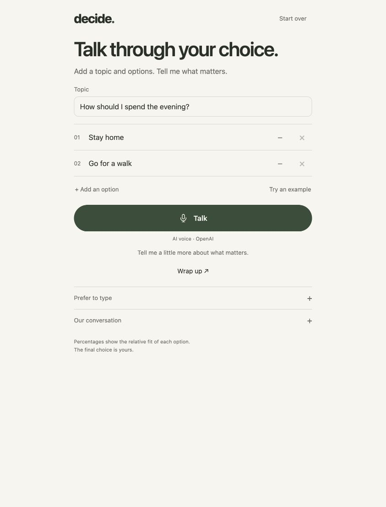
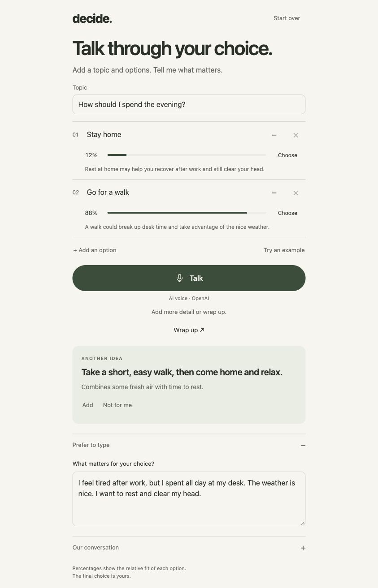
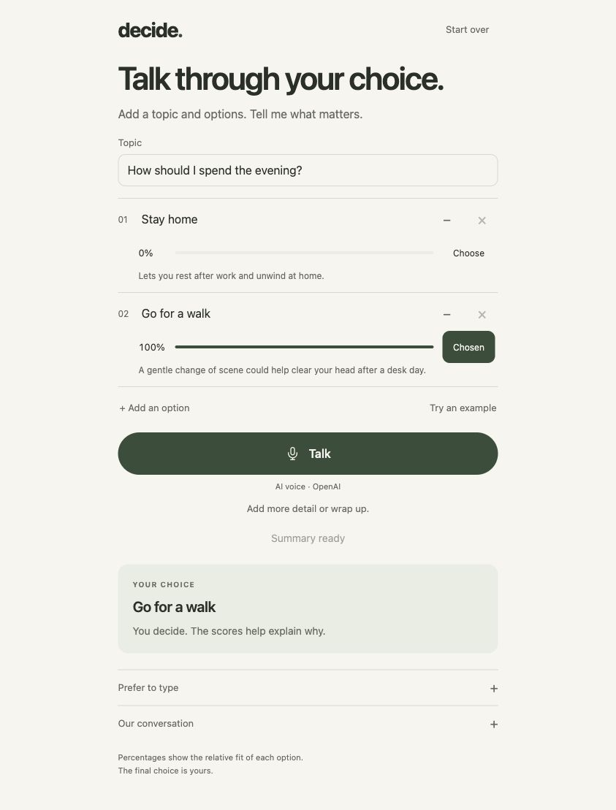

# Decide with me

A small local app for talking through everyday choices. Give it a topic and a few options, explain what matters, and compare the reasons. You make the final choice.

Built around the [OpenAI voice + Decisions pattern](https://developers.openai.com/api/docs/guides/decisions-voice). Plain Node.js, HTML, CSS and browser JavaScript. No dependencies or build step. The interface and AI replies are in English.

## Run locally

You need Node.js 22.16+ and an OpenAI API key with access to GPT-Live and Decisions.

```sh
cp .env.example .env
# Set OPENAI_API_KEY in .env.
npm start
```

Open [localhost:3000](http://localhost:3000). OpenAI usage is paid. **Try an example** fills in a decision and makes real API calls.

For development, use `npm run dev` and refresh the browser after frontend changes. Set `PORT` or override the model names in `.env` if needed.

## Use it

These screenshots show one real comparison in typed mode. Scores and suggestions depend on the details you provide.

### 1. Set up a choice

Enter a **Topic** and at least two option names. For example: “How should I spend the evening?”, **Stay home** and **Go for a walk**. This enables **Talk**. A topic and option names alone do not produce scores.



### 2. Explain what matters

Click **Talk**, allow microphone access, and describe your situation. The app updates the comparison as you speak. **Stop** ends the voice session and waits for the last transcript before comparing again.

Or open **Prefer to type** and write the same details. Here the user is tired after working at a desk, the weather is nice, and they want to rest and clear their head. The app shows reasons and relative scores, may ask a useful question, and can suggest another option. Use **Add** to include a suggestion or **Not for me** to dismiss it.



### 3. Wrap up and choose

Click **Wrap up** for a summary of the current comparison. During a voice conversation, this also ends the session. Then click **Choose** on the option you want. The **YOUR CHOICE** card records your decision; you can pick whichever option feels right.



Edit the topic, options or context to compare again. Use the minus button to exclude an option and **Start over** for a new decision. Close scores are presented as a close choice.

## How it works

- **GPT-Live** (`gpt-live-1`) handles speech over WebRTC. It delegates comparisons to the app and receives the results back in the same conversation.
- **Responses** (`gpt-6-luna`) writes short reasons, a useful question and an optional alternative. It excludes options only for explicit hard constraints.
- **Decisions** (`gpt-6-luna`) checks whether there is useful context and compares eligible options. Its choice probabilities are normalized and rounded to sum to 100.

The displayed scores are relative model estimates, not the odds of a successful outcome. They have not been calibrated on a dataset. Explicit corrections take priority over earlier statements; model exclusions stay separate from options you exclude yourself.

## Local by design

The website and server run on your machine; audio and model requests go to OpenAI. The server listens only on `127.0.0.1`. Your API key stays on the server in the ignored `.env` file.

State lives in the open browser tab and disappears on refresh. The app does not save recordings or transcripts. It uses `store: false` where the API supports it. To run it on another machine, supply that machine's own API key.

## Checks

```sh
npm test
```

Tests inject API responses and never spend OpenAI credits. They cover request shapes, topic validation, exclusions, missing or refused answers, rounding, local origin checks and keeping secrets out of static routes. Browser and live API smoke checks are recorded in [CHECKS.md](CHECKS.md).

MIT licensed.
