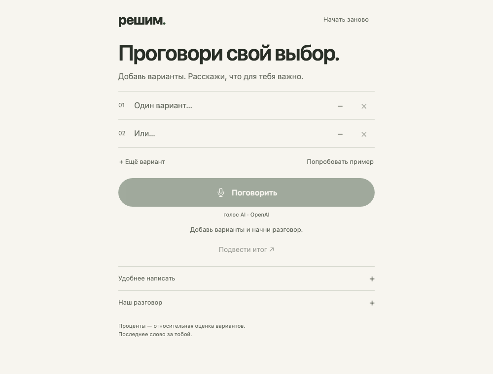
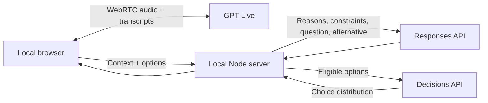

# решим. / Decide with me

A small voice companion for everyday decisions. Add your options, talk through what matters, and watch the comparison change. The final choice stays yours.

Built with the [OpenAI voice + Decisions pattern](https://developers.openai.com/api/docs/guides/decisions-voice). The interface is in Russian. Both the website and its server run locally; audio and model requests go to OpenAI.



## Run

Node.js 22.16+ and an OpenAI API key with access to GPT-Live and Decisions.

```sh
cp .env.example .env
# Set OPENAI_API_KEY in .env.
npm start
```

Open [localhost:3000](http://localhost:3000). No install or build step. Allow microphone access to talk, or open **Удобнее написать** to type. **Попробовать пример** fills in an ordinary decision and makes real API calls.

`npm run dev` restarts the server when its files change. Refresh the browser to see frontend changes. `PORT` changes the local port; model names can be overridden in `.env`.

## How it works



- **GPT-Live** (`gpt-live-1`) listens and speaks. Client delegation asks the app for a comparison; the app sends the result back to the same voice session.
- **Responses** (`gpt-6-luna`) produces short reasons, a useful question and an optional alternative. It excludes an option only for an explicit hard constraint.
- **Decisions** (`gpt-6-luna`) checks for useful context and compares the remaining options. The UI shows its choice probabilities, normalized and rounded to sum to 100. These are model estimates, **not probabilities of a successful outcome** or calibrated measures of preference. The initial context threshold is 0.6; it has not been calibrated on a dataset.

No scores appear before useful context. Rows retain their order. Explicit corrections take priority over earlier statements. Suggested options require a click to add; dismissed and removed suggestions stay out of subsequent proposals. A close result is presented as a close choice. Selecting **Выбрать** records your choice separately from the recommendation.

Stopping voice waits for `session.closed` before the final comparison, so the last transcript fragments can arrive. A timeout or dropped connection reports that the final phrase may be incomplete.

## Small on purpose

Four application files: `server.js`, `public/index.html`, `public/style.css`, `public/app.js`. Plain Node HTTP + fetch, HTML, CSS and browser JavaScript. Zero packages, no bundler, database, login, Docker or external assets. The server listens on `127.0.0.1` only.

The API key stays in the ignored `.env` file on the server. Session state exists only in the open browser tab and is lost on refresh. This app does not save recordings or transcripts. OpenAI receives the audio and context required for its APIs; `store: false` is used where available.

This is a local pet project for ordinary choices. To try it on another machine, clone it and supply that machine's own API key. OpenAI usage is paid. Access errors and provider failures are shown explicitly; there is no simulated score fallback.

## Check

```sh
npm test
```

Tests inject API responses and never spend OpenAI credits. They cover request shapes, excluded options, missing/refused answers, input validation, rounding, local origin checks and keeping secrets out of static routes. Browser checks and live API verification are recorded in [CHECKS.md](CHECKS.md).

Reference: [WebRTC](https://developers.openai.com/api/docs/guides/voice-webrtc), [client delegation](https://developers.openai.com/api/docs/guides/live-delegation), [Decisions](https://developers.openai.com/api/docs/guides/decisions), [structured outputs](https://developers.openai.com/api/docs/guides/structured-outputs).

MIT licensed.
